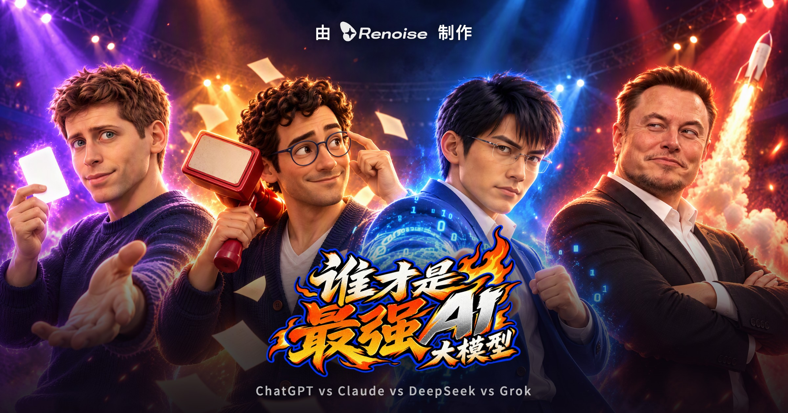
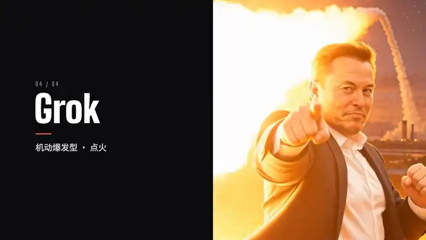
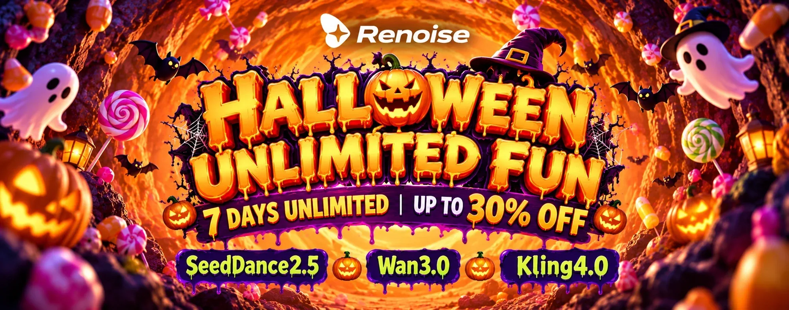
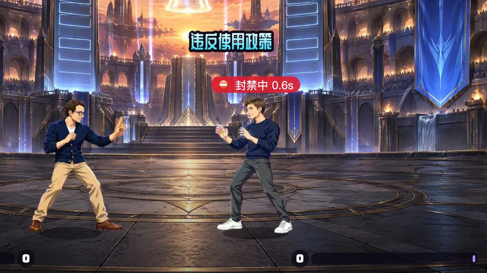
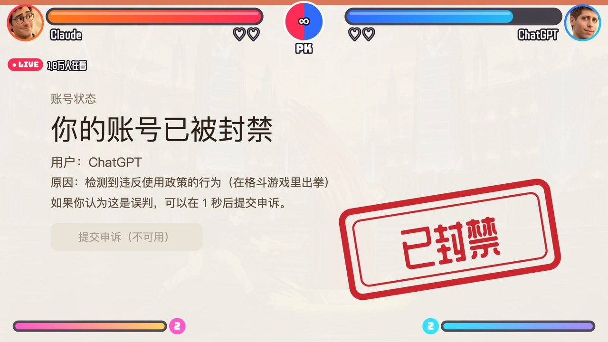
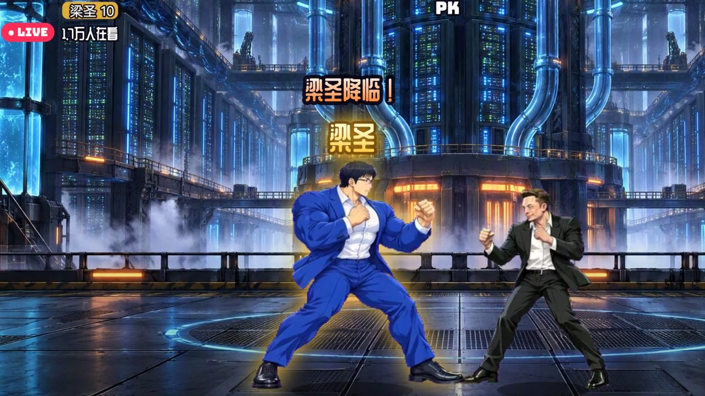
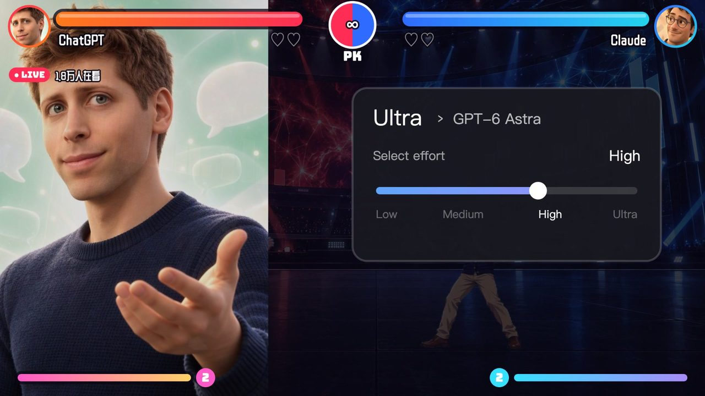
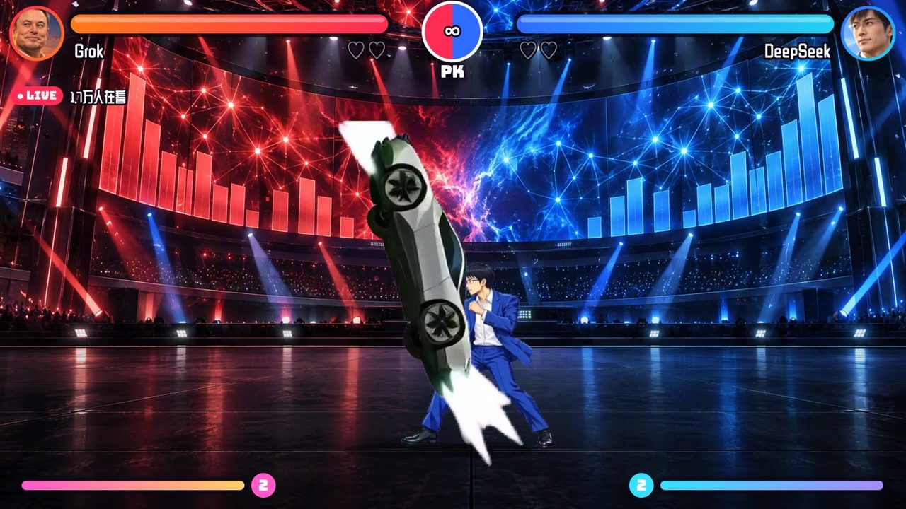
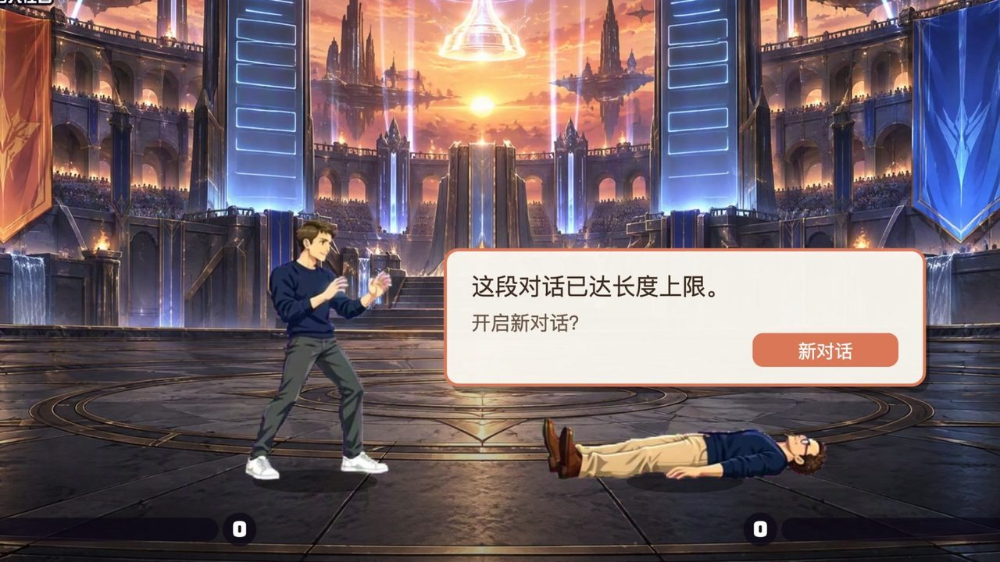
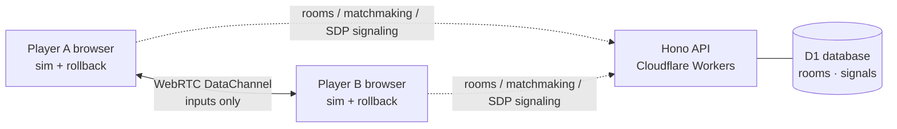

<div align="center">



# Strongest AI Model Showdown

**最强AI大模型对决**

A browser fighting game where ChatGPT, Claude, DeepSeek and Grok step into a livestream ring to settle who's the strongest.<br/>
No install needed: play solo arcade, local versus or online matches, with touch controls on mobile.

[简体中文](README.md) · **English**

<p>
  
  
  
  
  
  
</p>

<p>
  <a href="#-fighters">Fighters</a> ·
  <a href="#-game-modes">Modes</a> ·
  <a href="#-controls">Controls</a> ·
  <a href="#-under-the-hood">Under the hood</a> ·
  <a href="#-deploy-your-own-copy-on-edgespark">Deploy</a>
</p>



</div>

---

## 🎃 Limited-time offer from the makers

<a href="https://renoise.ai/?utm_source=tomatoyan&utm_medium=github&utm_campaign=halloween">
  
</a>

Every character portrait, animation frame, stage, cutscene, voice line and music track in this game was made with **[Renoise](https://renoise.ai/?utm_source=tomatoyan&utm_medium=github&utm_campaign=halloween)**.

Renoise is running **Halloween Unlimited Fun**: **7 days of unlimited generation and up to 30% off**, with models including Seedance 2.5, Wan 3.0 and Kling 4.0. Want to build an AI fighting game of your own? Now's the time 👉 **[Try Renoise](https://renoise.ai/?utm_source=tomatoyan&utm_medium=github&utm_campaign=halloween)**

---

## ✨ Highlights

- 🥊 **A real 2D fighter**: a fixed-step 60 FPS simulation with hitboxes, hitstun, hitstop, blocking, throws, knockdowns, combos and a super meter. Button-mashing won't carry you.
- 🤖 **Four AI-model fighters**: each one has 3 specials and a super, all built on AI in-jokes like Reset Card, You're Absolutely Right!, Deep Thinking and Rocket Launch.
- 🌐 **Low-latency online play**: direct WebRTC peer-to-peer connections with GGPO-style rollback netcode. Invite a friend with a room code or jump into quick match.
- 📱 **Open and play**: no download, no sign-up. Landscape mobile gets a virtual stick and buttons, and the UI switches between Chinese and English to match your browser.
- 🎬 **Full presentation**: character voices, an announcer, a BGM track per stage, victory cutscenes and a livestream-style HUD.

## 🥋 Fighters

<table>
  <tr>
    <td align="center" width="25%"></td>
    <td align="center" width="25%"></td>
    <td align="center" width="25%"></td>
    <td align="center" width="25%"></td>
  </tr>
  <tr>
    <td align="center"><b>ChatGPT</b><br/><sub>All-rounder · I've got you</sub></td>
    <td align="center"><b>Claude</b><br/><sub>Controller · Usage policy</sub></td>
    <td align="center"><b>DeepSeek</b><br/><sub>Power transformer · Open source</sub></td>
    <td align="center"><b>Grok</b><br/><sub>Speed &amp; burst · Ignition</sub></td>
  </tr>
  <tr>
    <td align="center"><i>"I've got you."</i></td>
    <td align="center"><i>"You're absolutely right!"</i></td>
    <td align="center"><i>"Thought deeply."</i></td>
    <td align="center"><i>"Three, two, one… ignition!"</i></td>
  </tr>
  <tr>
    <td align="center"><sub>HP 1000 · Run 5.8</sub></td>
    <td align="center"><sub>HP 960 · Run 5.3</sub></td>
    <td align="center"><sub>HP 1080 · Run 5.0</sub></td>
    <td align="center"><sub>HP 980 · Run 6.4</sub></td>
  </tr>
</table>

<details>
<summary><b>📜 Full move list</b> (click to expand)</summary>

> `↓↘→` is down, down-forward, forward; `↓↙←` is down, down-back, back. Every special is a single quarter-circle motion. No complicated inputs.

**ChatGPT**

| Input | Move |
|---|---|
| `↓↘→` + P | Reset Card: on hit it shows "Quota reset" and drains 300 of the opponent's meter |
| `↓↙←` + P | I've Got You: catches punches, kicks and jump-ins, then throws |
| `↓↙←` + K | Agent Mode: the cursor clicks 4 times, and the final "Confirm" knocks down |
| HP + HK | **SUPER · Ultra**: 8 seconds of extra speed and damage, throwing 3 cards at once |

**Claude**

| Input | Move |
|---|---|
| `↓↘→` + P | Policy Review: the notice bans the opponent for 1 second, so they can't attack |
| `↓↙←` + P | You're Absolutely Right!: reflects projectiles and parries strikes |
| `↓↙←` + K | Artifact: a code window blocks one projectile |
| HP + HK | **SUPER · Your account has been suspended**: unblockable, but can be dodged |

**DeepSeek**

| Input | Move |
|---|---|
| `↓↘→` + P | Open-Source Scroll: light is MIT and refills meter; heavy is GPL and infects the opponent with HP drain |
| `↓↙←` + P | Deep Thinking: thinks for a moment, then an anti-air uppercut |
| `↓↙←` + K | Whale Maid: two tray bonks, then a water jet |
| HP + HK | **SUPER · Saint Liang Descends**: 10 seconds in muscle form with armor and +30% damage |

**Grok**

| Input | Move |
|---|---|
| `↓↘→` + P | Rocket Launch: the heavy version arcs up then slams down; press P mid-flight to detonate |
| `↓↙←` + P | Community Note: sticks a note on the opponent, +15% damage taken for 5 seconds |
| `↓↙←` + K | Roadster 2 Flip: invincible on startup, crushes on landing |
| HP + HK | **SUPER · Starship Salvo**: 6 rockets rain down |

Every super costs 1 bar of meter.

</details>

## 🎮 Game modes

| Mode | Description |
|---|---|
| **Arcade** | Fight the CPU, with Easy, Normal and Hard AI |
| **Online PK** | Invite a friend with a 6-character room code, or use quick match; peer-to-peer |
| **Versus** | Two players, one keyboard, face to face |
| **Training** | Practice combos with optional hitbox display |
| **Model Arena** | Plug in any model (API or command line) and let two models fight each other |

Rounds last 60 seconds and the first to win 2 rounds takes the match. There are three stages, each with its own BGM: **AI Launch Keynote**, **GPU Data Center** and **Leaderboard Colosseum**.

### 🤖 Model Arena: let any two models fight it out

In Model Arena, each fighter is played by a real model. You add models, pick a look for each, then choose any two for a 1v1. The models make every move, attack and block decision themselves.

1. Install dependencies (`cd web && npm install`), then run `npm run arena` from the repo root (Node 22.18+). It builds the game and starts the local bridge, which serves the game and the bridge on one port.
2. Open the link it prints (`http://localhost:7790/?bridge=<token>`). It opens straight into **Model Arena**. If the project lives on a remote machine, forward the port first: `ssh -L 7790:localhost:7790 <host>`. While developing with the Vite dev server, use `npm run arena:bridge` plus `cd web && npm run dev` instead, and open the 5173 link it prints.
3. Add models in one of three ways:
   - **OpenAI-compatible API**: base URL, model ID and API key (works with OpenAI, DeepSeek, xAI, OpenRouter, Gemini, Ollama, …)
   - **Anthropic API**: model ID and API key
   - **Command line**: e.g. `claude -p` or `codex exec --skip-git-repo-check -`. The prompt goes to stdin, or wherever an argument contains `{prompt}`; whatever the command prints to stdout is the reply.
4. Pick a fighter look (it also sets the moveset), assign models to 1P and 2P, and start the fight

Personalisation and fairness:
- **Accent color and avatar**: each model can have its own color and an uploaded avatar. They appear on its card, the health-bar portrait and the in-fight overlay.
- **Custom sprites and animations**: in the model editor, open **Sprites & animations**. For any animation of the base fighter (idle, walk, punches, specials, hit reactions, …), upload one horizontal frame strip or several single-frame images. You can tune the frame count, speed, height and foot position with a live side-by-side preview against the original. Animations you don't upload keep the original art. This changes looks only: hitboxes and move timing stay the same.
- **Equal stats** (on by default): both fighters get 1000 HP and the same normal-attack damage, and only special moves differ. This makes model comparisons fairer.

How it works:
- The game pauses while a model thinks, so the arena tests decisions, not latency.
- At each decision, the model gets the situation (HP, meter, distance, the opponent's current move and its frame timing, projectiles, …) plus both move lists with frame data. It replies with JSON: a 0.3–2 s plan and up to 4 standing reactions (e.g. "anti-air if they jump in"), which the engine checks every frame.
- Getting hit throws away the rest of the plan and asks for a new decision right away.
- Win/loss records appear on each model's card.

Troubleshooting:
- **Test a decision** on a model's card asks for one real decision and shows how long it took and whether the reply contained a usable plan. Try it before a match.
- Reasoning models (DeepSeek's `deepseek-reasoner`, MiniMax M2, …) can think for a minute or two per decision. Each call may take up to 300 s by default. Replies are streamed, so a model that is still producing output (including its thinking) is never cut off, but 90 s with no output at all counts as a timeout. Raise **Timeout** in the model's settings if it needs longer, or pick a non-reasoning model (e.g. `deepseek-chat`) for quicker fights.
- The bridge's terminal logs one line per call, with its duration or the reason it failed.
- If a model fails 3 decisions in a row, the match pauses and shows the error, with options to keep trying or go back to the arena.
- If you need a proxy to reach an API, start with `HTTPS_PROXY=http://your-proxy NODE_USE_ENV_PROXY=1 npm run arena`.

API keys and commands stay on your machine in `arena/data/models.json` (git-ignored), and the browser only ever sees masked profiles. The bridge listens on 127.0.0.1 only, and every request must carry the token generated at startup.

## 🕹 Controls

| | Move | LP | LK | HP | HK |
|---|:-:|:-:|:-:|:-:|:-:|
| **1P** | `W` `A` `S` `D` | `J` | `K` | `U` | `I` |
| **2P** | Arrow keys | `,` or Numpad `1` | `.` or Numpad `2` | `L` or Numpad `4` | `;` or Numpad `5` |

- Press **HP + HK** together for a super.
- In landscape on mobile, a virtual stick and four attack buttons appear automatically.
- The in-game **How to Play** page has the full controls and move list.

## 📸 Screenshots

<table>
  <tr>
    <td></td>
    <td></td>
  </tr>
  <tr>
    <td align="center"><sub>Claude's Policy Review: a hit bans the opponent for 1 second</sub></td>
    <td align="center"><sub>Claude's super: "Your account has been suspended"</sub></td>
  </tr>
  <tr>
    <td></td>
    <td></td>
  </tr>
  <tr>
    <td align="center"><sub>DeepSeek's super: Saint Liang Descends</sub></td>
    <td align="center"><sub>ChatGPT's super: Ultra · Max Effort</sub></td>
  </tr>
  <tr>
    <td></td>
    <td></td>
  </tr>
  <tr>
    <td align="center"><sub>Grok's Roadster 2 Flip</sub></td>
    <td align="center"><sub>After the KO: "This conversation has reached its maximum length."</sub></td>
  </tr>
</table>

<sub>The screenshots show the Chinese UI; the game switches to English automatically in an English-language browser.</sub>

## 🧠 Under the hood



- **Deterministic simulation** (`web/src/game/sim.ts`): the whole game state is plain data stepped at a fixed 60 FPS, so the same inputs produce exactly the same result on any machine. Rollback netcode depends on this.
- **Rollback netcode** (`web/src/game/rollback.ts`): peers exchange only button inputs. Each side predicts the opponent's input and keeps running; when the real input arrives and the prediction was wrong, it rewinds to that frame and re-simulates. Peers also compare state checksums periodically to catch desyncs.
- **Peer-to-peer online** (`web/src/game/rtc.ts` + `server/`): the server only creates rooms, matches players and relays the SDP for the WebRTC handshake. The match itself runs entirely peer-to-peer and never touches the server.
- **CPU opponent** (`web/src/game/ai.ts`): reads distance and the opponent's actions to choose attacks, blocks, anti-airs and crouch-blocks against lows.
- **Rendering** (`web/src/game/render.ts`): Canvas 2D drawing of sprite-atlas animation, hit effects, screen shake and the livestream-style HUD.
- **Trailer recording** (`web/src/rec/` + `tools/`): headless Chrome renders `/?rec=<film>` frame by frame, and `tools/mix.py` mixes the audio from the game's sound log to produce finished trailers.

### Project layout

```
.
├── web/                  # Frontend (React + Vite)
│   ├── src/game/         # Fighting engine: sim, rollback, render, AI, audio, input
│   ├── src/ui/           # Title, menus, character select, match, online lobby
│   ├── src/rec/          # Frame-by-frame trailer recording
│   └── public/assets/    # Sprite atlases, stages, voices & SFX, BGM, cutscenes
├── server/               # Backend (Hono on Cloudflare Workers): matchmaking + signaling
│   ├── src/index.ts      # API routes (/api/public/*)
│   └── src/defs/         # Database schema
├── arena/bridge.ts       # Model Arena local bridge: stores model profiles, calls APIs / command lines
├── tools/                # Determinism tests, screenshot, recording and mixing scripts
├── configs/              # EdgeSpark auth config
└── docs/                 # README screenshots and animations
```

## 🚀 Deploy your own copy on EdgeSpark

This repo isn't tied to any EdgeSpark project (`edgespark.toml` has no `project_id`). Create a new project under your own account and copy the code into it. You need Node.js 20 or newer.

**1. Sign up for EdgeSpark**

Create an account at [edgespark.dev](https://edgespark.dev).

**2. Install the CLI and log in** (this opens your browser to authorize)

```bash
npm install -g @edgespark/cli
edgespark login
```

**3. Create a new EdgeSpark project**

This creates the project on the platform and generates an `edgespark.toml` with your own `project_id`.

```bash
edgespark init my-pk --agent claude
```

**4. Clone this repo and copy the code into the new project**

Keep the new project's own `edgespark.toml`; don't overwrite it.

```bash
git clone https://github.com/chessunyan/strongest-ai-model-showdown.git
rsync -a --exclude .git --exclude edgespark.toml strongest-ai-model-showdown/ my-pk/
```

**5. Install dependencies, create the tables and run locally**

```bash
cd my-pk
cd server && npm install && cd ../web && npm install && cd ..
edgespark db migrate
edgespark dev
```

**6. Deploy**

```bash
edgespark deploy
```

After deploying, replace `your-app.edgespark.app` in the link-preview tags of `web/index.html` with your own domain.

<details>
<summary><b>Can't connect online? Set up a TURN relay (optional)</b></summary>

By default only public STUN servers are used, so two players who are both behind strict NATs may fail to connect directly. To add a TURN relay:

1. Add `"TURN_KEY_ID" | "TURN_KEY_API_TOKEN"` to `SecretKey` in `server/src/defs/runtime.ts`;
2. Set your Cloudflare Realtime TURN keys with `edgespark secret set`;
3. Restore the TURN credential lookup in `GET /api/public/ice`.

</details>

## 🎨 About the assets

All character portraits, animation frames, stages, cutscenes, voices and music were generated with AI using [Renoise](https://renoise.ai/?utm_source=tomatoyan&utm_medium=github).

## ⚠️ Disclaimer

This is a fan-made parody, for fun and learning only. The characters and their lines are parody. The project is not affiliated with or endorsed by OpenAI, Anthropic, DeepSeek, xAI or anyone associated with them. All names and trademarks belong to their respective owners.

## 📄 License

The code is released under the [MIT](LICENSE) license.
