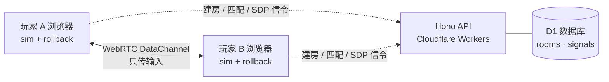

<div align="center">

# 最强AI大模型对决

**Strongest AI Model Showdown**

ChatGPT、Claude、DeepSeek、Grok 化身格斗家，在直播间里一决高下的网页格斗游戏。<br/>
打开浏览器就能玩，支持单人闯关、本地双人、联机对战，手机也能用触屏操作。

<p>
  
  
  
  
  
  
</p>

<p>
  <a href="#-角色">角色</a> ·
  <a href="#-游戏模式">游戏模式</a> ·
  <a href="#-操作">操作</a> ·
  <a href="#-技术亮点">技术亮点</a> ·
  <a href="#-部署到你自己的-edgespark-项目">部署</a>
</p>


</div>

---

## ✨ 特色

- 🥊 **正统 2D 格斗手感**：60 FPS 定点帧模拟，有判定框、硬直、顿帧、防御、投技、击倒起身、连段和能量槽，不是随便按的小游戏。
- 🤖 **四位 AI 大模型格斗家**：每位都有 3 个必杀技和 1 个超必杀，招式全部是 AI 圈的梗，比如「重置卡」、「你说得完全对！」、「已深度思考」、「火箭发射」。
- 🌐 **低延迟联机**：WebRTC 点对点直连，加上 GGPO 风格的回滚网络代码（rollback netcode），用房间码邀请好友，也可以快速匹配陌生人。
- 📱 **随开随玩**：不用下载、不用注册；手机横屏有虚拟摇杆和按键；界面中英双语，会自动跟随浏览器语言。
- 🎬 **完整的演出**：角色语音、比赛播报、三张舞台各自的 BGM、胜利过场动画，还有直播间风格的 HUD。

## 🥋 角色

<table>
  <tr>
    <td align="center" width="25%"></td>
    <td align="center" width="25%"></td>
    <td align="center" width="25%"></td>
    <td align="center" width="25%"></td>
  </tr>
  <tr>
    <td align="center"><b>ChatGPT</b><br/><sub>全能型 · 稳稳接住你</sub></td>
    <td align="center"><b>Claude</b><br/><sub>控场型 · 使用政策</sub></td>
    <td align="center"><b>DeepSeek</b><br/><sub>力量变身型 · 开源之力</sub></td>
    <td align="center"><b>Grok</b><br/><sub>机动爆发型 · 点火</sub></td>
  </tr>
  <tr>
    <td align="center"><i>「我会稳稳接住你。」</i></td>
    <td align="center"><i>「你说得完全对！」</i></td>
    <td align="center"><i>「已深度思考。」</i></td>
    <td align="center"><i>「倒计时，三、二、一，点火！」</i></td>
  </tr>
  <tr>
    <td align="center"><sub>体力 1000 · 跑速 5.8</sub></td>
    <td align="center"><sub>体力 960 · 跑速 5.3</sub></td>
    <td align="center"><sub>体力 1080 · 跑速 5.0</sub></td>
    <td align="center"><sub>体力 980 · 跑速 6.4</sub></td>
  </tr>
</table>

<details>
<summary><b>📜 全角色出招表</b>（点开查看）</summary>

> `↓↘→` 是下、前下、前；`↓↙←` 是下、后下、后。所有必杀技都只需要一个四分之一圈的搓招，不需要复杂的指令。

**ChatGPT**

| 指令 | 招式 |
|---|---|
| `↓↘→` + 拳 | 重置卡：命中时显示「额度已重置」，对手能量 −300 |
| `↓↙←` + 拳 | 稳稳接住你：接住对手的拳、脚或跳攻，抱起来甩出去 |
| `↓↙←` + 脚 | Agent 代操作：游标连点 4 下，最后一下「确认」击倒 |
| 重拳 + 重脚 | **超必杀 · Ultra**：8 秒内速度更快、伤害更高，一次甩出 3 张卡 |

**Claude**

| 指令 | 招式 |
|---|---|
| `↓↘→` + 拳 | 使用政策审查：警示单命中后封禁对手 1 秒，期间不能出招 |
| `↓↙←` + 拳 | 你说得完全对！：反弹飞行道具，也能招架拳脚 |
| `↓↙←` + 脚 | Artifact 生成：召出程序窗口，挡下一发飞行道具 |
| 重拳 + 重脚 | **超必杀 · 你的账号已被封禁**：不可防御，但可以闪避 |

**DeepSeek**

| 指令 | 招式 |
|---|---|
| `↓↘→` + 拳 | 开源卷轴：轻版是 MIT，回复能量；重版是 GPL，感染对手持续扣血 |
| `↓↙←` + 拳 | 已深度思考：先想一下再出升龙，用来对空 |
| `↓↙←` + 脚 | 召唤鲸鱼女仆：托盘拍两下，再喷出水柱 |
| 重拳 + 重脚 | **超必杀 · 梁圣降临**：10 秒内变身壮汉，霸体，攻击力 +30% |

**Grok**

| 指令 | 招式 |
|---|---|
| `↓↘→` + 拳 | 火箭发射：重版先上升再砸下；飞行中再按拳可以当场引爆 |
| `↓↙←` + 拳 | 社群注记：贴上便条，5 秒内对手受到的伤害 +15% |
| `↓↙←` + 脚 | Roadster 2 翻转飞跃：起手无敌，落地砸人 |
| 重拳 + 重脚 | **超必杀 · 星舰齐射**：6 枚火箭轮番轰炸 |

超必杀都需要消耗 1 格能量。

</details>

## 🎮 游戏模式

| 模式 | 说明 |
|---|---|
| **单人闯关** ARCADE | 和电脑对手打擂台，有简单、普通、困难三档 AI |
| **联机对战** ONLINE PK | 用 6 位房间码邀请好友，或进入快速匹配，P2P 直连 |
| **本地双人** VERSUS | 两人共用一个键盘面对面对打 |
| **训练模式** TRAINING | 练习连段，可以打开判定框显示 |

每局 60 秒，先赢 2 回合的一方获胜。舞台共三张：**大模型发布会**、**算力机房**、**巅峰榜单擂台**，各有自己的 BGM。

## 🕹 操作

| | 移动 | 轻拳 | 轻脚 | 重拳 | 重脚 |
|---|:-:|:-:|:-:|:-:|:-:|
| **1P** | `W` `A` `S` `D` | `J` | `K` | `U` | `I` |
| **2P** | 方向键 | `,` 或小键盘 `1` | `.` 或小键盘 `2` | `L` 或小键盘 `4` | `;` 或小键盘 `5` |

- 同时按 **重拳 + 重脚** 发动超必杀。
- 手机横屏时会自动显示虚拟摇杆和四个攻击键。
- 游戏内的「操作说明」页里有完整的按键说明和出招表。

## 📸 截图

<table>
  <tr>
    <td></td>
    <td></td>
  </tr>
  <tr>
    <td align="center"><sub>Claude「使用政策审查」：命中后对手被封禁 1 秒</sub></td>
    <td align="center"><sub>Claude 超必杀「你的账号已被封禁」</sub></td>
  </tr>
  <tr>
    <td></td>
    <td></td>
  </tr>
  <tr>
    <td align="center"><sub>DeepSeek 超必杀「梁圣降临」</sub></td>
    <td align="center"><sub>ChatGPT 超必杀「Ultra · Effort 拉满」</sub></td>
  </tr>
  <tr>
    <td></td>
    <td></td>
  </tr>
  <tr>
    <td align="center"><sub>Grok「Roadster 2 翻转飞跃」</sub></td>
    <td align="center"><sub>KO 之后：「这段对话已达长度上限」</sub></td>
  </tr>
</table>

## 🧠 技术亮点



- **确定性模拟**（`web/src/game/sim.ts`）：全部游戏状态都是纯数据，按固定 60 FPS 步进，同样的输入在任何机器上都得到完全相同的结果，这是回滚联机的基础。
- **回滚网络代码**（`web/src/game/rollback.ts`）：双方只交换按键输入。本地先预测对手的输入继续跑，等真实输入到达后发现预测错了，就回到那一帧重新模拟；还会定期交换状态校验和，检查两边有没有不同步。
- **P2P 联机**（`web/src/game/rtc.ts` + `server/`）：服务器只负责建房、匹配，以及转发 WebRTC 握手用的 SDP，对战本身完全点对点，不经过服务器。
- **电脑对手**（`web/src/game/ai.ts`）：会看距离和对手动作来决定出招、防御、对空和蹲防下段。
- **渲染**（`web/src/game/render.ts`）：Canvas 2D 绘制精灵图集动画、打击特效、画面震动和直播间风格的 HUD。
- **宣传片录制**（`web/src/rec/` + `tools/`）：用无头 Chrome 逐帧渲染 `/?rec=<film>`，再用 `tools/mix.py` 按游戏内的声音日志混音，直接产出宣传片。

### 项目结构

```
.
├── web/                  # 前端（React + Vite）
│   ├── src/game/         # 格斗引擎：模拟、回滚、渲染、AI、音频、输入
│   ├── src/ui/           # 标题、菜单、选人、对战、联机大厅等界面
│   ├── src/rec/          # 宣传片逐帧录制
│   └── public/assets/    # 精灵图集、舞台、语音音效、BGM、过场视频
├── server/               # 后端（Hono on Cloudflare Workers）：匹配 + 信令
│   ├── src/index.ts      # API 路由（/api/public/*）
│   └── src/defs/         # 数据库表结构
├── tools/                # 确定性测试、截图、录制与混音脚本
├── configs/              # EdgeSpark 认证配置
└── docs/                 # README 用的截图和动图
```

## 🚀 部署到你自己的 EdgeSpark 项目

这个仓库不绑定任何 EdgeSpark 项目（`edgespark.toml` 里没有 `project_id`），你需要用自己的账号新建一个项目，再把代码放进去。需要 Node.js 20 以上版本。

**1. 注册 EdgeSpark 账号**

到 [edgespark.dev](https://edgespark.dev) 注册。

**2. 安装 CLI 并登录**（会打开浏览器完成授权）

```bash
npm install -g @edgespark/cli
edgespark login
```

**3. 新建一个 EdgeSpark 项目**

这一步会在平台上创建项目，并生成带有你自己 `project_id` 的 `edgespark.toml`。

```bash
edgespark init my-pk --agent claude
```

**4. 克隆本仓库，把代码复制进新项目**

要保留新项目自己的 `edgespark.toml`，不要覆盖它。

```bash
git clone https://github.com/chessunyan/strongest-ai-model-showdown.git
rsync -a --exclude .git --exclude edgespark.toml strongest-ai-model-showdown/ my-pk/
```

**5. 安装依赖、建表、本地运行**

```bash
cd my-pk
cd server && npm install && cd ../web && npm install && cd ..
edgespark db migrate
edgespark dev
```

**6. 部署上线**

```bash
edgespark deploy
```

部署之后，把 `web/index.html` 里分享卡片用的 `your-app.edgespark.app` 换成你自己的域名。

<details>
<summary><b>联机连不上？配置 TURN 中继（可选）</b></summary>

默认只使用公共 STUN 服务器，双方都在严格 NAT 后面时可能无法直连。如果需要 TURN 中继：

1. 在 `server/src/defs/runtime.ts` 的 `SecretKey` 里加上 `"TURN_KEY_ID" | "TURN_KEY_API_TOKEN"`；
2. 用 `edgespark secret set` 配置 Cloudflare Realtime TURN 的 key；
3. 在 `GET /api/public/ice` 里加回 TURN 凭证的获取逻辑。

</details>

## 🎨 素材说明

角色立绘、动作帧、舞台、过场视频、配音和音乐全部由 AI 生成，使用的工具是 [Renoise](https://renoise.ai)。

## ⚠️ 免责声明

本项目是粉丝向的恶搞同人作品，仅供娱乐和学习交流。游戏中的角色形象与台词都是戏仿创作，与 OpenAI、Anthropic、DeepSeek、xAI 等公司及其相关人士没有任何关联，也未获得他们的认可。相关名称和商标归各自所有者所有。

## 📄 License

代码以 [MIT](LICENSE) 协议开源。
